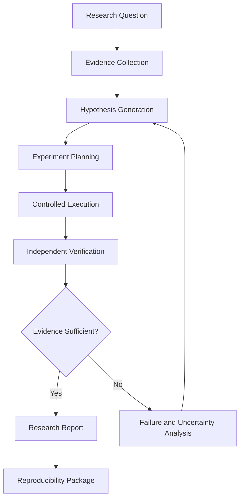
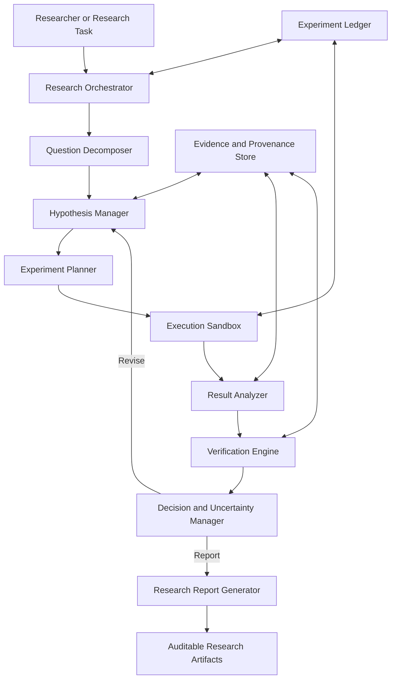

# BAYES
### An Autonomous Scientific Discovery Engine

**From Hypothesis to Verified Discovery.**

BAYES is a research initiative by **Novum Labs Private Limited** to develop an autonomous scientific discovery engine that systematically generates hypotheses, designs computational experiments, evaluates evidence, verifies results, and learns from unsuccessful investigations.

The long-term objective is to move beyond AI systems that merely generate plausible explanations toward a reproducible scientific workflow in which proposed findings are supported by explicit evidence, executable experiments, measurable results, and independent verification.

> **Core principle:** A plausible answer is not a scientific discovery. A discovery requires evidence, testing, and reproducibility.

---

## Table of Contents

- [1. Overview](#1-overview)
- [2. The Problem](#2-the-problem)
- [3. Vision and Objectives](#3-vision-and-objectives)
- [4. Proposed Capabilities](#4-proposed-capabilities)
- [5. Scientific Discovery Workflow](#5-scientific-discovery-workflow)
- [6. Proposed System Architecture](#6-proposed-system-architecture)
- [7. Evidence and Verification](#7-evidence-and-verification)
- [8. Research Domains](#8-research-domains)
- [9. Evaluation Framework](#9-evaluation-framework)
- [10. Technology Strategy](#10-technology-strategy)
- [11. Repository Structure](#11-repository-structure)
- [12. Development Roadmap](#12-development-roadmap)
- [13. Reproducibility Standards](#13-reproducibility-standards)
- [14. Safety and Responsible Research](#14-safety-and-responsible-research)
- [15. Current Status and Limitations](#15-current-status-and-limitations)
- [16. Getting Started](#16-getting-started)
- [17. Contributing](#17-contributing)
- [18. Research Outputs and Publications](#18-research-outputs-and-publications)
- [19. Citation](#19-citation)
- [20. License](#20-license)
- [21. About Novum Labs](#21-about-novum-labs)

---

## 1. Overview

Scientific research is an iterative process involving observation, hypothesis formation, experimentation, evidence evaluation, and revision. Although modern AI systems can assist with many of these activities, producing a convincing explanation is not equivalent to demonstrating that the explanation is correct.

BAYES aims to integrate these activities into a structured computational workflow.

The proposed engine will coordinate specialized components for:

- Scientific question formulation.
- Hypothesis generation and prioritization.
- Literature and evidence retrieval.
- Experiment planning.
- Computational execution.
- Statistical analysis and uncertainty estimation.
- Independent result verification.
- Failure analysis and hypothesis revision.
- Reproducible research reporting.

Rather than treating an AI-generated response as the final output, BAYES will treat it as a candidate claim that must pass appropriate validation procedures.

### Project identity

| Property | Description |
|---|---|
| Project | BAYES |
| Initial target version | 1.0 |
| Organization | Novum Labs Private Limited |
| Category | Artificial intelligence and scientific computing |
| Primary objective | Autonomous scientific discovery |
| Core approach | Hypothesis-driven, evidence-based experimentation |
| Intended outputs | Verified computational findings and reproducible research reports |
| Development status | Research and engineering project |

The name BAYES is inspired by Bayesian reasoning, in which beliefs or probability distributions are updated using evidence. The project is not restricted to Bayesian algorithms; its methodology may combine statistical inference, symbolic reasoning, optimization, simulation, search, and machine learning.

---

## 2. The Problem

Current AI-assisted research workflows face several important challenges.

### 2.1 Plausible but unverified claims

A language model can produce a coherent explanation without establishing that its claims are correct. Fluency and confidence are not reliable substitutes for experimental evidence.

### 2.2 Weak connections between hypotheses and experiments

Generating a hypothesis is only one part of scientific reasoning. A useful discovery system must translate hypotheses into tests capable of supporting, rejecting, or refining them.

### 2.3 Limited reproducibility

Research results are difficult to audit when datasets, configurations, random seeds, software versions, execution logs, and evaluation procedures are missing.

### 2.4 Inadequate failure analysis

An unsuccessful experiment can provide valuable information. A research system should identify why a test failed, distinguish implementation errors from hypothesis failures, and use the findings to guide subsequent experiments.

### 2.5 Evaluation without independent verification

A system should not validate its own conclusions solely by repeating the reasoning that produced them. Verification should use appropriate independent checks, such as reference implementations, analytical solutions, held-out observations, statistical tests, or separate evaluation procedures.

### 2.6 Unclear scientific novelty

A result that is correct is not necessarily new. Establishing novelty requires comparing the finding against relevant prior work and documenting the scope and limitations of the comparison.

BAYES is designed to investigate these challenges through a transparent and testable scientific workflow.

---

## 3. Vision and Objectives

### Vision

Develop a reliable AI research system that can investigate well-defined scientific questions, conduct computational experiments, evaluate the resulting evidence, and produce findings that other researchers can inspect and reproduce.

### Primary objectives

1. **Hypothesis generation:** Produce explicit, testable hypotheses from a defined research question and available evidence.
2. **Adaptive experimentation:** Select useful experiments based on expected information gain, cost, feasibility, or scientific relevance.
3. **Evidence-grounded reasoning:** Connect important claims to identifiable data, references, calculations, or experiment outputs.
4. **Independent verification:** Evaluate findings through checks that are appropriate to the scientific problem and sufficiently independent of the original generation process.
5. **Learning from failure:** Record unsuccessful experiments and use their results to revise the investigation.
6. **Reproducibility:** Preserve sufficient information to rerun and audit computational experiments.
7. **Scientific reporting:** Generate reports that distinguish observations, interpretations, assumptions, uncertainty, and unresolved questions.

These are project objectives. Their successful implementation and performance must be established through engineering tests and empirical evaluation.

---

## 4. Proposed Capabilities

BAYES is intended to develop the following capabilities incrementally.

### 4.1 Research question decomposition

Convert a broad question into smaller, operationally defined questions.

Each question should specify:

- The claim or phenomenon under investigation.
- Relevant assumptions and constraints.
- Required inputs and available evidence.
- What observations would support or contradict the claim.
- A measurable success or rejection criterion.

### 4.2 Hypothesis generation

Generate multiple candidate explanations rather than prematurely committing to a single answer.

Each hypothesis should include:

- A unique identifier.
- A precise statement.
- Supporting observations.
- Known counterevidence.
- Testable predictions.
- Required assumptions.
- Proposed experiments.
- Confidence or uncertainty estimates, when meaningful.

### 4.3 Experiment planning

Translate hypotheses into executable or otherwise evaluable tests.

The experiment planner should consider:

- Scientific relevance.
- Expected information gain.
- Computational cost.
- Feasibility.
- Reproducibility.
- Potential confounding variables.
- Appropriate baseline comparisons.

### 4.4 Computational experimentation

Where supported by the selected research domain, BAYES may execute controlled experiments using numerical methods, simulations, statistical procedures, or machine-learning models.

Each execution should record its configuration, inputs, outputs, environment, and errors.

### 4.5 Independent verification

Evaluate results using a verification strategy selected for the task.

Possible methods include:

- Analytical derivation.
- Numerical consistency checks.
- Unit and property-based tests.
- Independent implementations.
- Statistical validation.
- Comparison with trusted reference results.
- Replication using new random seeds or held-out data.

No single verification method is suitable for every scientific problem.

### 4.6 Failure analysis

When an experiment fails, the system should record the failure rather than silently discard it.

Possible categories include:

- Invalid hypothesis.
- Incorrect assumptions.
- Data quality problems.
- Implementation defects.
- Numerical instability.
- Inadequate experimental design.
- Insufficient evidence.
- Resource or execution failures.

The system should distinguish these categories where possible and avoid treating every failure as evidence that the underlying scientific hypothesis is false.

### 4.7 Research report generation

Produce structured reports containing:

- Research question.
- Hypotheses considered.
- Relevant prior evidence.
- Experimental methodology.
- Software and configuration details.
- Results and evaluation metrics.
- Verification outcomes.
- Uncertainty and limitations.
- Failed or inconclusive experiments.
- Conclusions supported by the evidence.
- Instructions for reproduction.

---

## 5. Scientific Discovery Workflow

The proposed workflow is organized into eight stages.



### Stage 1 — Define the question

Establish the research objective, scope, constraints, and measurable evaluation criteria.

### Stage 2 — Collect evidence

Retrieve or generate relevant evidence, preserving provenance and identifying uncertainty or missing information.

### Stage 3 — Generate hypotheses

Produce testable candidate explanations and identify their distinguishing predictions.

### Stage 4 — Plan experiments

Choose experiments capable of discriminating between hypotheses, with explicit baselines and success criteria.

### Stage 5 — Execute experiments

Run approved computational procedures in a controlled environment and record their outputs.

### Stage 6 — Verify results

Check the findings using appropriate independent methods and identify discrepancies.

### Stage 7 — Revise the investigation

If the evidence is insufficient, revise the hypothesis, experiment, implementation, or assumptions as justified.

### Stage 8 — Report and reproduce

Publish a structured account of the investigation and preserve the artifacts needed to reproduce it.

The workflow is iterative. A completed run may produce a verified finding, an inconclusive result, a rejected hypothesis, or a documented failure. The system must not force every investigation into a positive conclusion.

---

## 6. Proposed System Architecture

BAYES will be developed as a modular system so that components can be tested, replaced, and evaluated independently.



### Proposed components

| Component | Responsibility |
|---|---|
| Research orchestrator | Coordinate the investigation and manage task state |
| Question decomposer | Convert broad questions into testable subproblems |
| Hypothesis manager | Create, track, compare, and revise candidate hypotheses |
| Evidence manager | Store source references, observations, and provenance |
| Experiment planner | Select tests, baselines, and evaluation criteria |
| Execution sandbox | Run approved computational experiments with resource limits |
| Result analyzer | Calculate metrics and summarize observed outcomes |
| Verification engine | Apply independent checks and identify inconsistencies |
| Decision manager | Determine whether to accept, reject, revise, or defer a conclusion |
| Experiment ledger | Preserve configurations, execution logs, and experiment history |
| Report generator | Produce transparent and reproducible research reports |

These are architectural targets, not a claim that all components currently exist in working software.

### Design principles

**Modularity:** Components should have explicit interfaces and testable responsibilities.

**Observability:** Important decisions, execution events, and failures should be traceable.

**Replaceability:** Models and tools should be replaceable without redesigning the entire system.

**Verification independence:** Where feasible, verification should use a different method or implementation from the one that generated the result.

**Fail-closed behavior:** Unsupported or unverifiable conclusions should be marked inconclusive rather than automatically accepted.

**Controlled execution:** Generated code and external tools should run under explicit permission, resource, and security constraints.

---

## 7. Evidence and Verification

Verification is central to BAYES.

The system should distinguish between the following concepts:

| Concept | Meaning |
|---|---|
| Plausibility | A claim appears reasonable given current knowledge |
| Evidence support | Available observations or sources support the claim |
| Computational correctness | A calculation or implementation passes the relevant checks |
| Experimental validation | Results support the claim under a defined experimental design |
| Reproducibility | Another execution can reproduce the documented procedure and assess its outcome |
| Scientific novelty | The finding is meaningfully different from relevant prior knowledge |

These properties are related but not interchangeable.

### Proposed verification record

Each evaluated claim should eventually have a structured record containing:

```json
{
  "claim_id": "claim-001",
  "hypothesis": "A clearly stated, testable claim",
  "evidence": [],
  "experiment_ids": [],
  "verification_methods": [],
  "observed_results": [],
  "uncertainty": null,
  "status": "pending",
  "limitations": []
}
```

This is an illustrative data contract. The final schema should be defined and validated in the implementation.

### Possible outcome states

- `pending` — evaluation has not been completed.
- `supported` — the defined evidence supports the claim within the tested scope.
- `rejected` — the defined tests contradict the claim or its predictions.
- `inconclusive` — the available evidence does not justify a decision.
- `failed` — the experiment could not be completed or evaluated successfully.
- `needs_review` — human assessment is required.

A claim marked `supported` should not automatically be described as universally true or as a novel scientific discovery.

---

## 8. Research Domains

BAYES will initially prioritize domains in which computational experiments and verification can be defined precisely.

### 8.1 Mathematics and formal reasoning

Potential investigations include:

- Conjecture generation for constrained mathematical problems.
- Symbolic manipulation and theorem-proving assistance.
- Counterexample search.
- Numerical exploration of mathematical patterns.
- Verification of candidate solutions.

A numerical pattern alone is not a proof. Formal or analytical verification is required when the claim is mathematical in the strict sense.

### 8.2 Algorithms and computer science

Potential investigations include:

- Algorithm design and optimization.
- Complexity experiments.
- Benchmark-driven comparisons.
- Program synthesis for constrained tasks.
- Automated testing and counterexample discovery.

### 8.3 Statistics and machine learning

Potential investigations include:

- Model comparison.
- Ablation studies.
- Hyperparameter and algorithmic experiments.
- Statistical hypothesis testing.
- Robustness and generalization analysis.
- Uncertainty estimation.

### 8.4 Computational science

Potential investigations include:

- Numerical simulations.
- Parameter estimation.
- Model validation.
- Sensitivity analysis.
- Reproducible computational experiments.

The initial implementation should focus on a narrow, measurable domain before attempting broad autonomous scientific research.

---

## 9. Evaluation Framework

BAYES must be evaluated against explicit baselines rather than judged by demonstrations alone.

### 9.1 Functional evaluation

Test whether individual components behave according to their specifications.

Examples include hypothesis-schema validation, experiment-state transitions, execution error handling, and report generation.

### 9.2 Scientific evaluation

Measure whether the system produces testable hypotheses and whether its experiments meaningfully distinguish competing explanations.

### 9.3 Verification evaluation

Measure the rate at which supported and unsupported claims are correctly classified using an independently established reference standard.

### 9.4 Reproducibility evaluation

Repeat experiments under documented conditions and compare outputs, metrics, and sources of variation.

### 9.5 Efficiency evaluation

Measure computational cost, wall-clock time, experiment count, and resource consumption relative to baselines.

### Proposed metrics

| Metric | Purpose |
|---|---|
| Hypothesis testability rate | Fraction of hypotheses with operationally defined tests |
| Verification accuracy | Agreement with an appropriate reference standard |
| False acceptance rate | Fraction of unsupported claims incorrectly accepted |
| Experiment success rate | Fraction of planned experiments completed successfully |
| Reproducibility rate | Fraction of repeat runs meeting predefined reproducibility criteria |
| Information gain | Reduction in uncertainty attributable to an experiment, where measurable |
| Cost per validated result | Resources consumed per result meeting the defined validation criteria |
| Failure diagnosis accuracy | Agreement between failure classifications and reviewed causes |

Metrics should be reported with their definitions, denominators, datasets, test conditions, and uncertainty where appropriate.

**No benchmark scores or performance claims are asserted in this README.** Results should be added only after experiments have been run and documented.

---

## 10. Technology Strategy

The technology stack will be selected according to the needs of the first working research workflow.

Potential technologies include:

- **Python** for orchestration, scientific computing, and experimentation.
- **NumPy and SciPy** for numerical computation and scientific methods.
- **PyTorch** for machine-learning components when needed.
- **SymPy** for symbolic mathematics and exact calculations.
- **pytest** for automated testing.
- **Pydantic or JSON Schema** for structured data validation.
- **SQLite or PostgreSQL** for experiment metadata and research records.
- **Git** for source control and reproducible development history.

These are candidate technologies, not a declaration that the repository already uses them.

### Model and tool independence

BAYES should avoid depending unnecessarily on a single language model or provider. Where appropriate, the system should support interchangeable reasoning models, deterministic tools, scientific libraries, and independent verification procedures.

External model calls should be recorded at an appropriate level of detail, including model identifier, configuration, timestamp, and relevant request metadata, while protecting secrets and sensitive data.

---

## 11. Repository Structure

The following is a proposed repository layout. Directories should be added as their corresponding components are implemented.

```text
BAYES/
├── README.md
├── LICENSE
├── CONTRIBUTING.md
├── CODE_OF_CONDUCT.md
├── CITATION.cff
├── pyproject.toml
├── .gitignore
├── .env.example
├── docs/
│   ├── architecture.md
│   ├── research-methodology.md
│   ├── verification-policy.md
│   └── evaluation-protocol.md
├── configs/
│   └── default.yaml
├── src/
│   └── bayes/
│       ├── __init__.py
│       ├── orchestrator/
│       ├── hypotheses/
│       ├── evidence/
│       ├── experiments/
│       ├── execution/
│       ├── verification/
│       ├── evaluation/
│       └── reporting/
├── tests/
│   ├── unit/
│   ├── integration/
│   └── evaluation/
├── examples/
├── benchmarks/
├── data/
│   └── README.md
├── artifacts/
│   └── README.md
└── reports/
    └── README.md
```

### Directory responsibilities

- `src/`: Core application code.
- `tests/`: Unit, integration, and evaluation tests.
- `docs/`: Architecture, methodology, and technical documentation.
- `configs/`: Version-controlled, non-secret experiment configurations.
- `examples/`: Small examples demonstrating supported workflows.
- `benchmarks/`: Evaluation tasks, protocols, and benchmark utilities.
- `data/`: Dataset instructions and metadata; large or restricted datasets may remain external.
- `artifacts/`: Documentation for generated artifacts, rather than a place to commit large model files by default.
- `reports/`: Research reports and reproducibility summaries.

The actual repository tree should be kept synchronized with the README as development progresses.

---

## 12. Development Roadmap

Development will proceed through measurable stages. Each stage should have defined deliverables, tests, and acceptance criteria.

### Phase 1 — Research foundation

- Define the initial scientific domain.
- Select a small set of research tasks.
- Establish reference answers or trusted evaluation procedures.
- Define hypothesis, experiment, and evidence schemas.
- Create the project structure and development standards.

**Exit criterion:** A documented problem definition and an executable baseline evaluation protocol.

### Phase 2 — Minimal working discovery loop

- Implement structured hypothesis input and storage.
- Create an experiment-planning interface.
- Execute a small set of controlled computational experiments.
- Store results and execution metadata.
- Produce a basic research report.

**Exit criterion:** A complete end-to-end run on at least one defined task.

### Phase 3 — Verification engine

- Implement task-appropriate validation methods.
- Add independent checks and reference comparisons.
- Track supported, rejected, failed, and inconclusive outcomes.
- Test behavior against deliberately incorrect results.

**Exit criterion:** Automated tests demonstrate that the verification workflow distinguishes defined success and failure cases.

### Phase 4 — Adaptive experimentation

- Maintain competing hypotheses.
- Select follow-up experiments using explicit criteria.
- Record previous outcomes.
- Revise investigation plans when evidence warrants it.

**Exit criterion:** A repeatable experiment sequence demonstrates that earlier results influence subsequent experiment selection.

### Phase 5 — Evaluation and reproducibility

- Establish benchmark tasks and baseline systems.
- Run repeated trials.
- Measure accuracy, cost, failure modes, and reproducibility.
- Publish evaluation protocols and limitations.

**Exit criterion:** A documented evaluation report with reproducible procedures and measured results.

### Phase 6 — Research release

- Finalize public documentation.
- Add installation instructions and supported examples.
- Review security and dependency management.
- Publish a versioned release when the implementation meets its acceptance criteria.

**Exit criterion:** A usable release with tests, documented limitations, and reproducible example runs.

These phases describe the intended roadmap. They do not imply that any phase has already been completed.

---

## 13. Reproducibility Standards

Every experiment intended to support a published result should preserve sufficient metadata for an independent reviewer to understand and, where feasible, repeat it.

A research record should include:

- Unique experiment identifier.
- Research question and hypothesis identifiers.
- Dataset name, version, and provenance.
- Data preprocessing steps.
- Code revision or Git commit.
- Software and dependency versions.
- Model and tool identifiers.
- Configuration and relevant random seeds.
- Hardware and execution environment when material.
- Experiment start and completion times.
- Output artifacts and evaluation metrics.
- Verification procedure and result.
- Known sources of nondeterminism.
- Errors, deviations, and limitations.

### Reproducibility principles

1. Keep raw input data immutable where practical.
2. Record transformations between raw and processed data.
3. Separate training, validation, and test data appropriately.
4. Avoid using evaluation data to make unreported tuning decisions.
5. Record failed runs as well as successful runs.
6. Avoid claiming exact reproducibility when nondeterministic operations or external services prevent it.
7. Never commit API keys, passwords, private datasets, or other secrets.
8. Document external dependencies and any restrictions on data or model redistribution.

Reproducibility means that the procedure and evidence can be examined. It does not guarantee that every independent run will produce identical results.

---

## 14. Safety and Responsible Research

Autonomous experimentation introduces risks involving generated code, external services, data handling, and uncontrolled execution.

BAYES should adopt the following safeguards as relevant capabilities are introduced.

### Execution isolation

- Execute generated code only in a controlled environment.
- Apply CPU, memory, time, disk, and process limits.
- Restrict filesystem access and network connectivity by default.
- Avoid executing untrusted code directly on a developer's host machine.
- Require explicit authorization for privileged operations.

### Research integrity

- Preserve evidence that contradicts a hypothesis.
- Avoid fabricating citations, results, or experimental observations.
- Distinguish measured results from model-generated interpretations.
- Report inconclusive findings honestly.
- Avoid describing correlation as causation without an appropriate design.

### Human oversight

Human review should be required for high-impact conclusions, sensitive research activities, changes to execution permissions, and actions that exceed the approved experimental scope.

### Data and security

- Use least-privilege access.
- Keep credentials outside source control.
- Respect dataset licenses, access restrictions, and privacy requirements.
- Document known limitations and potential sources of bias.

These are intended design requirements. Their implementation must be verified before the system is used for consequential autonomous experimentation.

---

## 15. Current Status and Limitations

**BAYES is a research and engineering initiative.** The architecture, capabilities, and roadmap described here define the intended direction of development.

Unless separately demonstrated by source code, tests, and documented experimental results, the following should be treated as planned rather than implemented:

- Autonomous hypothesis generation.
- Automatic experiment planning.
- Sandboxed experiment execution.
- Independent verification.
- Adaptive learning from experiment failures.
- Automated scientific reporting.
- Demonstrated scientific discoveries.

BAYES should not be considered a validated autonomous scientist or a replacement for expert scientific review.

Potential limitations include dependence on the quality of available evidence, errors in generated hypotheses, incomplete literature coverage, computational resource constraints, evaluation bias, and the difficulty of establishing novelty.

The scope of every reported finding must remain limited to what the relevant evidence and experiments actually demonstrate.

---

## 16. Getting Started

The repository's implementation determines the actual installation and execution commands. Until the initial executable workflow and dependency configuration are available, there is no verified installation command for BAYES.

Once the first runnable release is published, this section should specify the supported Python version, installation procedure, configuration requirements, example command, expected output, and tests.

### Intended initial workflow

1. Clone the repository.
2. Create an isolated Python environment.
3. Install the dependencies declared by the project.
4. Configure required settings using documented environment variables.
5. Run the smallest supported example.
6. Execute the automated test suite.
7. Inspect the generated experiment record and research report.

Do not assume that a command or example is supported until it has been tested against the repository's actual code.

### Development prerequisites

The expected development environment may include:

- Python.
- Git.
- A virtual environment tool.
- The dependencies specified in the project configuration.
- Optional model-provider credentials if external model services are integrated.

The final release documentation should state exact supported versions and tested commands.

---

## 17. Contributing

Contributions are welcome when they improve scientific rigor, implementation quality, reproducibility, usability, or evaluation.

Potential contribution areas include:

- Hypothesis representation and management.
- Experiment planning algorithms.
- Scientific computing integrations.
- Independent verification methods.
- Benchmark design.
- Reproducibility tooling.
- Security and sandboxing.
- Documentation and examples.

### Contribution expectations

1. Open or review an issue describing the problem before undertaking substantial changes.
2. Keep changes focused and explain their motivation.
3. Add tests for new functionality and bug fixes.
4. Document assumptions and limitations.
5. Include reproducible evidence for changes affecting scientific results.
6. Do not submit credentials, private data, or unlicensed research material.
7. Avoid unsupported performance or scientific novelty claims.

Pull requests should explain what changed, how it was tested, and any remaining limitations.

The project's contribution process may be formalized in `CONTRIBUTING.md` as the repository matures.

---

## 18. Research Outputs and Publications

BAYES is intended to support research outputs that can be independently inspected.

Potential outputs include:

- Technical architecture reports.
- Experiment protocols.
- Benchmark results.
- Ablation studies.
- Failure analyses.
- Reproducibility packages.
- Research papers and supplementary artifacts.

A research publication should describe the experimental setup, relevant baselines, evaluation methods, negative results, uncertainty, and limitations.

Claims of scientific novelty should be made only after an appropriately scoped review of existing work. Correctness, usefulness, and novelty should be evaluated separately.

No publication, benchmark result, or scientific discovery is claimed by this README.

---

## 19. Citation

If BAYES produces research that is formally published, this section should be updated with the publication details and a valid citation.

A prospective BibTeX entry may be added after the authorship, title, year, and publication information have been established. Until then, citation metadata should not be fabricated.

For software citation, the project may use a `CITATION.cff` file with accurate author, version, release, and repository information.

---

## 20. License

The project's license must be selected and added to the repository before public reuse terms are advertised.

Until a license file is present, users should not assume that the code is released under an open-source license or that redistribution and commercial use are permitted.

Any third-party code, models, datasets, or dependencies must retain their applicable license and attribution requirements.

---

## 21. About Novum Labs

**BAYES is being developed by Novum Labs Private Limited** as part of its work in artificial intelligence, machine learning, scientific computing, and research-oriented software engineering.

The project aims to investigate how AI systems can move from generating candidate explanations toward conducting structured, evidence-driven, and reproducible computational investigations.

### Project principle

> Generate hypotheses. Test them rigorously. Verify the evidence. Report what the experiments actually show.

---

*BAYES — From Hypothesis to Verified Discovery.*

*An AI research initiative by Novum Labs Private Limited.*
